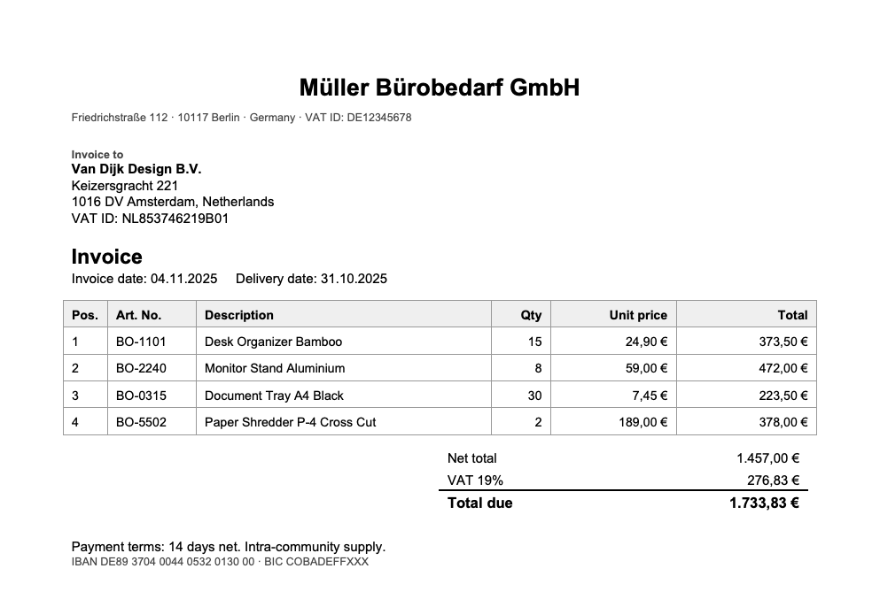
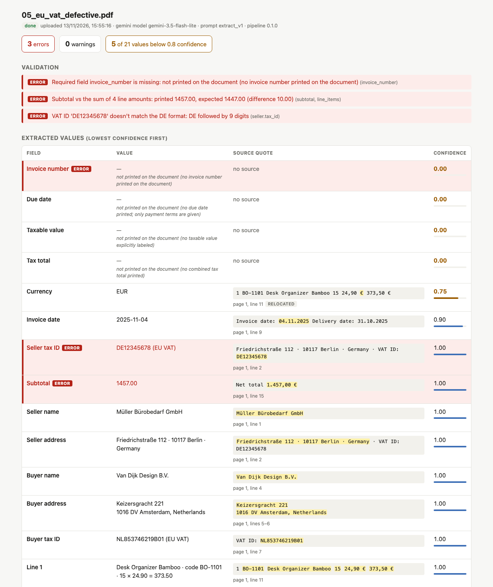

<!--
What:     Project front page for prospective clients and contributors: the problem, how it works, measured accuracy, how to run it.
In:       Nothing; numbers come from the accuracy run recorded below (scripts/evaluate.py).
Out:      An honest account of what the pipeline does well, where it fails, and why each dependency exists.
Fails if: It claims more than the harness measured. Re-run scripts/evaluate.py and update the tables after any pipeline change.
-->

# Invoice Intelligence

Turns invoice PDFs, including scanned ones, into structured JSON where **every value cites the page,
line and verbatim text it came from**, with a confidence score. Every value can be checked against the
document in seconds, so nobody has to trust it blindly.

## The problem

Invoice data entry is slow, and automating it with OCR or an LLM creates a new problem: you get numbers
you can't check. When an extractor says the grand total is 6,65,388.00, *where did that come from?* Was it
read from the document, or did the model add up the line items, or invent it? In accounts payable a silent
error costs more than a slow one.

This pipeline treats extraction as **transcription plus evidence**:
- The LLM is only allowed to copy text and say where it is printed. It never calculates or decides.
- Python checks every citation against the actual page text and rejects anything that isn't there.
- Python does all parsing, arithmetic and validation, so a total that doesn't add up is flagged, not "fixed".
- A reviewer sees each value next to its source quote, lowest confidence first.

## Before and after

**Before:** an invoice with deliberate defects (fixture 05). The line items add up to 1.447,00 € but the net total
says 1.457,00 €, the German VAT ID is one digit short, and there is no invoice number.



**After:** the review page for that invoice, from the live accuracy run (Gemini `gemini-3.5-flash-lite`,
2026-11-13). The three defects are flagged in red with readable reasons. Missing values sort to the top with the
model's explanation. Each value sits beside the exact line it came from, with the value highlighted. The currency
citation was **relocated**: the model pointed at a line that didn't contain "€", the check found it on a line-item row,
and the confidence dropped to 0.75 to show it.



## What you get

Every field carries its provenance. From a live run on fixture 03, a two-column layout where the buyer's address
shares its lines with the invoice dates:

```json
"address": {
  "value": "Near Zero Mile, Civil Lines\nNagpur, Maharashtra 440001",
  "source": {
    "page": 1, "line_start": 6, "line_end": 7,
    "quote": "Near Zero Mile, Civil Lines Due Date: 07/12/2025\nNagpur, Maharashtra 440001 Order Ref: VCC/PO/7781",
    "match_type": "exact", "text_source": "text_layer", "confidence": 1.0
  },
  "missing_reason": null
}
```

A value that isn't printed is `null` **with a reason**, never a guess. Money is serialized as strings
(`"665388.00"`), never floats. Validation problems arrive as structured flags with readable messages, e.g.
`Subtotal vs the sum of 4 line amounts: printed 1457.00, expected 1447.00 (difference 10.00)`.

## How it works

1. **Page text** ([app/extract.py](app/extract.py)): pdfplumber reads the text layer. Each page is checked
   separately: if its text layer is missing, garbled or covered by a scan, it goes to Tesseract OCR instead.
2. **Transcription** ([app/llm.py](app/llm.py), [app/gemini.py](app/gemini.py)): the LLM sees line-numbered page
   text and must fill a strict JSON schema with *exact text plus page and line*, nothing else. The prompt is
   versioned ([app/prompts/extract_v1.md](app/prompts/extract_v1.md)) and stamped on every result.
3. **Citation check** ([app/provenance.py](app/provenance.py)): each value is looked up on the cited line(s), then in
   order: exact, normalized (case, spacing, dashes), elsewhere on the page or document (the citation is corrected),
   approximate on the cited line only. The value returned is always **the page's text**, not the model's copy. A value
   that can't be found is dropped and flagged. Failed citations go back to the model once for repair.
4. **Parsing** ([app/parse.py](app/parse.py)): Indian `1,22,248.00`, European `1.457,00 €`, accounting negatives,
   several date formats. Ambiguity, like `05/11/2025` or `1,234`, is resolved only by other evidence on the same
   invoice, or rejected. It is never guessed.
5. **Confidence**: match quality × OCR confidence of the quoted lines × parse certainty. A heuristic, not a
   probability; the calibration table below shows it means something.
6. **Validation** ([app/validate.py](app/validate.py)): line amounts, line items vs subtotal, tax lines vs tax total,
   tax rate × taxable value, subtotal + tax + adjustments vs grand total (with documented rounding tolerances),
   required fields, dates, GSTIN format and check digit, EU VAT formats, and GST type vs the parties' states.

## Measured accuracy

Five synthetic invoices with hand-written ground truth (one of them a rotated, specked scan), one live run:

- **Model:** Gemini `gemini-3.5-flash-lite` (free tier), prompt `extract_v1`, run 2026-11-13
- **Result: 341 of 357 fields correct (95.5%)**, 9 wrong, 7 missed, **0 spurious** (no invented values)

| Document | What it tests | Fields correct | Flags as expected |
|---|---|---|---|
| 01 classic GST | Indian number grouping, CGST + SGST | 50/50 (100%) | yes |
| 02 IGST, totals on top | Totals box above the items, columnar labels | 41/42 (97.6%) | yes |
| 03 two pages | 30 line items over 2 pages, discount, round-off | 181/181 (100%) | yes |
| 04 **scanned, rotated** | Image-only page through OCR | **27/42 (64.3%)** | no |
| 05 EU, deliberately broken | `1.457,00 €` format, wrong net total, bad VAT ID, no invoice number | 42/42 (100%) | yes |

**Confidence calibration.** Are high-confidence values more often right?

| Confidence | Values | Accuracy |
|---|---|---|
| 0.95 – 1.00 | 290 | 100% |
| 0.80 – 0.95 | 16 | 81% |
| below 0.80 | 19 | 68% |

The per-field table, and every incorrect field with expected vs actual values, are in the run report
(`scripts/evaluate.py` writes it to `data/eval/<timestamp>/report.md`).

**Read these numbers with care.**
- Five synthetic invoices are not a benchmark. Four of them have clean text layers, which is the easy case.
- No real-world invoices have been measured yet (`tests/fixtures/private/` is empty).
- One run of a non-deterministic model: expect a few fields to change between runs.

## Known failure modes

Observed in the run above:
- **Skewed scans scramble tables.** On the 1.5°-rotated scan (04), Tesseract read the item table column by column and
  put the first row last. The model then paired descriptions with the wrong rows, so all four descriptions were shifted
  by one. The other columns were rejected as unreadable rather than mismatched. *Likely fixes: deskew small angles before
  OCR, and rebuild table rows from word positions.*
- **OCR character noise.** `O7AAHFY2206P1ZS` (letter O for zero), `18/1 1/2025`, stray marks such as `15,663.60.`. Such
  values are **rejected and flagged, not guessed**. Validation then correctly reports the GSTINs as malformed, because
  that is what the page text says, so the scan raises flags its clean original wouldn't.
- **A misread digit with clean punctuation would pass.** `1,325.00` was OCR'd as `4,325.00.` and rejected only
  because of the trailing dot. A clean misread would be accepted at low confidence and caught only by the arithmetic
  checks. This is why low-confidence values sort to the top of the review page.
- **The model can skip a field-meaning rule.** On 02 it didn't report the "Taxable Value" box as the subtotal, which
  the prompt asks for when it's the only pre-tax total. That gives a missed value, not a wrong one.

By design:
- No handling of photographed, perspective-warped pages or handwriting.
- The GST type check uses the buyer's GSTIN state as a stand-in for the place of supply, which isn't extracted, so it
  only warns.
- EU VAT numbers are checked for format only; national check digits aren't verified. GSTIN check digits are.
- A day/month-ambiguous date with no evidence on the invoice is rejected, not guessed.

## Quick start

```bash
python3 -m venv .venv
.venv/bin/pip install -r requirements-dev.txt
cp .env.example .env              # add GEMINI_API_KEY (default provider) or ANTHROPIC_API_KEY
brew install tesseract            # OCR for scanned pages
.venv/bin/pytest                  # no network needed; live tests are opt-in
```

**Run the API and review page:**
```bash
.venv/bin/uvicorn app.main:create_app --factory
```
Open http://127.0.0.1:8000/, upload a PDF, and check each value against its source quote. Or use the API directly:
```bash
curl -F "file=@invoice.pdf" http://127.0.0.1:8000/extract   # 202 {"id": ..., "status": "pending", "result_url": ...}
curl http://127.0.0.1:8000/result/<id>                       # poll until status is "done" or "failed"
```
Each upload makes one or two LLM calls (two when an answer needs repair). Jobs run in the background inside the
server; a job interrupted by a restart is marked `failed` at the next startup. Uploads and results are stored under
`DATA_DIR` (default `./data`, gitignored).

**Measure accuracy:**
```bash
.venv/bin/python scripts/evaluate.py                      # all fixtures with ground truth
.venv/bin/python scripts/evaluate.py --only 04_scanned_rotated
```
Fields are scored as correct, correctly absent, wrong, missed or **spurious** (a value where none is printed),
plus page attribution, validation flags and confidence calibration. A document that fails counts as wrong on every
field. Real invoices in `tests/fixtures/private/` are included only with `--include-private`, and never through the
Gemini free tier.

## LLM providers

`LLM_PROVIDER` picks who transcribes: **`gemini`** (default, `gemini-3.5-flash-lite`) or `anthropic`
(`claude-opus-5-5`). Both get the same prompt, must fill the same schema (Gemini's `responseSchema` is generated
from the Pydantic contract), and go through the same checks. Every result records the provider and model.
`LLM_MODEL` overrides the model.

Gemini is called through `generateContent`, which Google documents as fully supported (its newer Interactions API is
recommended for new projects but not required). The adapter retries rate limits with backoff, using the server's
suggested delay, and stops with a clear message once the daily quota is used up.

> **Data on the Gemini free tier:** Google may use free-tier prompts and responses to improve its products, and human
> reviewers may read them. Send only synthetic or non-confidential invoices through it. For real documents, use a
> billed Google Cloud project or the Anthropic provider.

## Project layout

```
app/models.py        Pydantic contract: LLM wire schema, typed invoice, flags, results, ground-truth format
app/extract.py       PDF -> line-numbered page text, per-page OCR fallback
app/llm.py           Provider choice, Claude client, extraction with one repair round
app/gemini.py        Gemini adapter
app/provenance.py    Citation checks, verbatim quotes, confidence
app/parse.py         Amounts, dates, rates, currencies, tax-ID schemes
app/assemble.py      LLM output -> verified, typed invoice
app/validate.py      Business rules -> flags (tolerances documented in the module)
app/pipeline.py      One document end to end; failures become failed results
app/storage.py       Uploads and results as files, written atomically
app/main.py          FastAPI app: POST /extract, GET /result/{id}, review page at /
static/              Review page (vanilla HTML/JS, strict Content-Security-Policy)
scripts/             Fixture generator and accuracy harness
tests/               pytest suite; fixtures/expected holds the hand-written ground truth
```

## Tests

`.venv/bin/pytest` runs about 450 tests with no network access. LLM answers are mocked, including deliberately wrong
ones, to prove the citation checks reject them. Tests that need Tesseract or Node.js skip if those aren't installed. One
live end-to-end test runs only with `RUN_LIVE_TESTS=1`.

**Python:** tested on 3.14.3 (macOS x86_64); every dependency installs from prebuilt wheels. Minimum 3.12.

## Dependencies

| Package | Why it's here |
|---|---|
| fastapi | The HTTP API, validated by the same Pydantic models |
| uvicorn | Server for FastAPI |
| python-multipart | Required by FastAPI for file uploads |
| pydantic | The schema contract; imported directly, so pinned directly |
| pdfplumber | Text layer with positions; also renders pages for OCR (via pypdfium2), so no poppler |
| pytesseract | Thin wrapper over the Tesseract OCR binary |
| anthropic | Official SDK for the Claude provider |
| httpx | Gemini over plain REST (no Google SDK); bundles CA certificates, which the stdlib's `urllib` lacked on the tested Python build. Also used by FastAPI's test client |
| python-dotenv | Loads `.env` |
| *dev:* pytest | Test runner |
| *dev:* reportlab | Generates the synthetic fixture PDFs (pinned so they regenerate byte-identically) |
| *optional:* Node.js | Runs the review page's logic tests with Node's built-in runner; skipped if absent |

Deliberately absent: pandas, OpenCV, rapidfuzz (stdlib `difflib` is enough), any database, any frontend framework.
